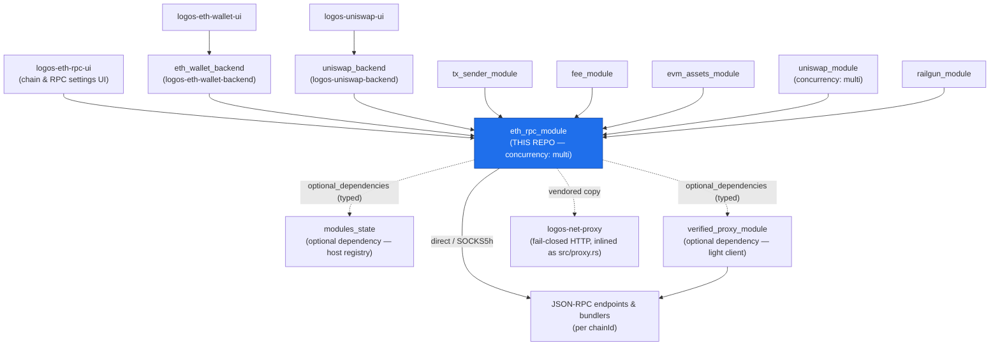
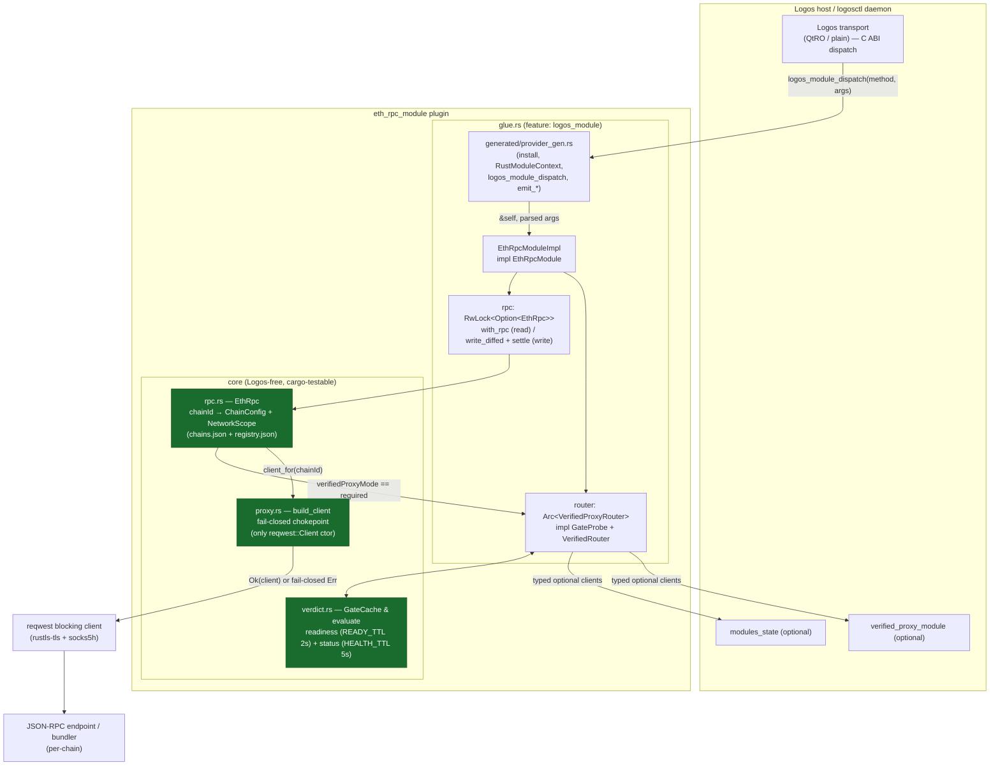

# `eth_rpc_module` — Specification & Reference

> Device-wide EVM chain registry and proxyable, fail-closed Ethereum JSON-RPC client for Logos wallets and dapps.
> Per-chain config (endpoint, registry metadata, SOCKS proxy policy, optional light-client verified routing); RPC calls keyed by `chainId`; `socks5h`/Tor-ready.

This document is the exhaustive reference for **`logos-evm-eth-rpc-module`**
(`github.com/logos-co/logos-evm-eth-rpc-module`). It is grounded entirely in the
repository source: `metadata.json`, `rust-lib/src/{lib.rs,glue.rs,rpc.rs,verdict.rs,proxy.rs}`,
`rust-lib/Cargo.toml`, `flake.nix`, `CMakeLists.txt`, `.github/{workflows,gates}/`, and the
executable doc-test under `doctests/`.

---

## 1. Purpose & place in the system

The Logos EVM stack is built as a set of **Logos modules** — process-isolated plugins that
talk over a Logos transport (QtRO / plain) via a typed RPC bridge. A module exposes methods
(here, a Rust trait) that other modules or the `logosctl` daemon invoke through a generated
client.

`eth_rpc_module` is both the **device-wide EVM chain registry** and the **multi-chain
JSON-RPC transport** for every wallet and dapp on the device:

- It **stores per-chain configuration and registry metadata** (RPC endpoint, chain name,
  native asset symbol/decimals, testnet classification, enabled flag, SOCKS/HTTP proxy
  policy, and verified-routing mode), keyed by `chainId` and persisted to `chains.json`
  alongside device-wide scope and default-seeding state in `registry.json`.
- It exposes **13 `chainId`-keyed JSON-RPC methods** (`eth_blockNumber`, `eth_getBalance`,
  `eth_call`, `eth_sendRawTransaction`, …, plus `raw_rpc` and `raw_rpc_url` escape hatches),
  stamping every answer with its `route` (`"verified"`, `"proxied"`, or `"direct"`).
- On direct HTTP routes, every outbound request is built through a **single fail-closed
  chokepoint** (`src/proxy.rs`, an inlined copy of `logos-net-proxy`): a chain configured
  with `proxyRequired` and no usable proxy **refuses to send** rather than leaking traffic
  in the clear.
- On chains configured with `verifiedProxyMode: "required"`, calls route through the
  optional **`verified_proxy_module`** light client (gated by `verdict.rs` via
  **`modules_state`** + `verified_proxy_module.status()`) and **refuse rather than falling
  back** to an unverified endpoint if the light client cannot answer.
- It is declared `concurrency: "multi"` (see §9): its 13 RPC methods are blocking network
  or cross-module round-trips, so the module opts into concurrent dispatch — one slow call
  does not stall the others.

### Where it sits in the wallet dependency graph



`eth_rpc_module` has **no required Logos-module dependencies** (`dependencies: []`) so it
loads and serves direct JSON-RPC on any host even when the light-client stack is not
installed. Its two **optional** dependencies — `modules_state` and `verified_proxy_module`
(`~0.2.0`) — are typed LIDL contracts consulted only when a chain enables
`verifiedProxyMode: "required"` (or when a UI queries `verified_proxy_status`).

---

## 2. Module identity (`metadata.json`)

| Field | Value | Meaning |
|-------|-------|---------|
| `name` | `eth_rpc_module` | Module id used by `logosctl`/`logoscore`/`lgpm`/callers. |
| `version` | `0.2.0` | Module version. |
| `description` | *Proxyable, fail-closed Ethereum JSON-RPC client. Per-chain config (endpoint + proxy); RPC calls keyed by chainId. socks5h/Tor-ready.* | |
| `author` | `Logos Core Team` | |
| `type` | `core` | Core (headless) module, not a UI plugin. |
| `interface` | `cdylib` | Rust-first module (`Cargo.toml` builds `["staticlib", "rlib"]` linked into the thin CMake plugin wrapper). |
| `concurrency` | `multi` | Opts into concurrent handler dispatch (§9). |
| `category` | `wallet` | |
| `main` | `eth_rpc_module_plugin` | Built plugin binary name. |
| `dependencies` | `[]` | **No required Logos-module dependencies** — loads without the light client. |
| `optional_dependencies` | `["modules_state", { "name": "verified_proxy_module", "version": "~0.2.0" }]` | Typed optional contracts used by the verified-proxy gate and router (§5.5); tolerated when absent (`optional_skipped`). |
| `include` / `capabilities` | `[]` | None. |
| `codegen.rust` | `{ crate: "rust-lib", trait: "EthRpcModule", source: "src/glue.rs" }` | The builder derives the module's `.lidl` contract from `EthRpcModule` (and `EthRpcModuleEvents`). |
| `nix` | empty `external_libraries` / `packages` / `cmake` | Pure-Rust TLS (`rustls-tls`); zero OpenSSL or `libverifproxy`/Nimbus Closure linkage. |

The public API of the module is defined by `EthRpcModule` and `EthRpcModuleEvents` in
`rust-lib/src/glue.rs` (§5).

---

## 3. Overall architecture

The crate has two clean layers:

1. **Crypto-free, Logos-free core** (`rpc.rs` + `verdict.rs` + `proxy.rs`) — plain Rust,
   unit-tested with `cargo test --no-default-features` (105 unit tests). Zero `unsafe`, zero
   Logos runtime dependencies.
2. **Logos glue** (`glue.rs`) — compiled only under the default `logos_module` feature.
   Implements `EthRpcModule`, wraps `EthRpc` in a `RwLock`, wires `VerifiedProxyRouter`
   (backed by `GateCache` + typed `modules_state` / `verified_proxy_module` clients), emits
   diffed events, and registers the module with the host via the generated multi-mode
   provider scaffold.



### Internal pieces

| File | Type / fn | Role |
|------|-----------|------|
| `lib.rs` | crate root | Declares `mod proxy; mod rpc; mod verdict;` and `#[cfg(feature="logos_module")] mod glue;`. Re-exports core types and helpers. |
| `rpc.rs` | `EthRpc` | Chain registry & RPC client: `HashMap<u64, ChainConfig>`, `NetworkScope`, `offered_defaults`, `chains.json` + `registry.json` persistence, verified-leg routing, and typed RPC helpers. |
| `rpc.rs` | `ChainConfig` / `ChainConfigWire` | Stored per-chain record and caller wire patch form (`camelCase` serde) preserving omitted verified & registry fields. |
| `rpc.rs` | `BuiltinChain` / `DEFAULT_CHAINS` / `ConfigSource` / `NetworkScope` | Built-in chain definitions (Ethereum, Sepolia, Hoodi), provenance tracking, and `mainnets`/`testnets`/`both` scoping. |
| `rpc.rs` | `VerifiedProxyMode` / `VerifiedClass` / `VerifiedRouter` | Verified routing mode (`off` \| `required`), proof classification (`verified` \| `proxied` \| `direct`), param/result normalization, and router trait seam. |
| `rpc.rs` | `RpcError` | 10-variant error enum with machine-readable `.code()` tokens (`unknown_chain`, `proxy`, `http`, `timeout`, `rpc`, `parse`, `verified_proxy`, `verified_blocked`, `verified_bypass`, `overrides_unsupported`). |
| `verdict.rs` | `Verdict` / `Readiness` / `GateCache` / `evaluate` | Logos-free verified-proxy state machine, `modules_state`-first readiness check (`READY_TTL = 2 s`), `status()` classifier (`HEALTH_TTL = 5 s`), and `hop_budget`. |
| `proxy.rs` | `ProxyConfig` / `ProxyError` / `build_client` | **The only** `reqwest::blocking::Client` constructor; enforces scheme allowlist and fail-closed `proxyRequired`. |
| `glue.rs` | `EthRpcModule` / `EthRpcModuleEvents` | Public contract: **29 methods** + `on_context_ready` hook + **4 events**. |
| `glue.rs` | `EthRpcModuleImpl` / `VerifiedProxyRouter` | Holds `rpc: RwLock<Option<EthRpc>>` and `router: Arc<VerifiedProxyRouter>`; implements `with_rpc` (read) and `write_diffed` / `settle` (`mutate`, `mutate_bool`). |
| `glue.rs` | `logos_module_install` | `#[no_mangle]` install hook → `install::<EthRpcModuleImpl>()`. |
| *generated* | `generated/provider_gen.rs` | `include!`d by `glue.rs`; generated at build time in **multi** mode (C-ABI dispatch, `install`, `RustModuleContext`, `emit_*`, and typed optional dependency clients). Not checked in (`.gitignore` excludes `rust-lib/generated/`). |

---

## 4. Communication with dependencies (data flow)

Every RPC call takes one of two legs depending on the chain's `verifiedProxyMode`:
- **`"off"` (direct leg):** builds a per-call `reqwest::blocking::Client` through `proxy.rs`
  (failing closed if `proxyRequired && no proxy`) and POSTs directly (or via `socks5h`) to
  the chain's configured `endpoint`.
- **`"required"` (verified leg):** checks `GateCache` (`modules_state.list_modules()` →
  `verified_proxy_module.status()`), coerces parameters (`verified_params`), dispatches
  `verified_proxy_module.rpc()` within the remaining hop budget, normalizes the result back
  to JSON-RPC wire format, and **refuses on any failure without falling back to the direct
  endpoint**.

```mermaid
sequenceDiagram
    autonumber
    participant Caller as backend / ui / tx_sender / logosctl
    participant Glue as glue.rs (EthRpcModuleImpl, &self)
    participant State as RwLock&lt;Option&lt;EthRpc&gt;&gt;
    participant Gate as VerifiedProxyRouter + GateCache
    participant Proxy as proxy.rs build_client (fail-closed)
    participant Node as JSON-RPC endpoint / verified_proxy_module

    Note over Caller,State: Config / registry write path (exclusive WRITE lock + post-lock events)
    Caller->>Glue: set_chain_config / patch_chain_endpoint / init_defaults
    Glue->>State: write_diffed (WRITE lock) → persist(chains.json / registry.json)
    State-->>Glue: guard dropped + ChainChange diff
    Glue->>Gate: gate.invalidate(chain_id)
    Glue-->>Caller: emit chain_config_changed / verified_proxy_mode_changed / chain_enabled_changed

    Note over Caller,Node: Per-call read path (concurrency: multi — shared READ lock)
    Caller->>Glue: get_balance(1, "0x..addr")
    Glue->>State: with_rpc (READ lock — overlaps other reads)
    alt verifiedProxyMode == "required"
        State->>Gate: router.call(1, "eth_getBalance", [addr,"latest"], budget)
        Gate->>Node: modules_state.list_modules() + verified_proxy_module.status() + rpc()
        Node-->>State: verified value (or RouterError::Blocked / Failed — never falls back)
        State-->>Glue: Ok("0x1234"), route = "verified"
        Glue-->>Caller: {"ok":true,"result":"0x1234","route":"verified"}
    else verifiedProxyMode == "off"
        State->>Proxy: client_for(1) → build_client(ProxyConfig)
        alt proxy_required && no usable proxy
            Proxy-->>Glue: Err(ProxyRequiredButUnset) ❌ fail-closed
            Glue-->>Caller: {"ok":false,"code":"proxy","error":"proxy: proxy required..."}
        else proxy OK (or not required)
            Proxy-->>State: reqwest blocking client
            State->>Node: POST eth_getBalance [addr,"latest"]
            Node-->>State: {"jsonrpc":"2.0","result":"0x1234"}
            State-->>Glue: Ok("0x1234"), route = "direct"
            Glue-->>Caller: {"ok":true,"result":"0x1234","route":"direct"}
        end
    end
```

### How specific callers drive it

- **`eth_wallet_backend`** and **`uniswap_backend`** call `init_defaults` unconditionally on
  every start, read the chain registry with `list_chain_configs`, relay
  `verified_proxy_status`, and subscribe to `chain_config_changed`, `chain_enabled_changed`,
  and `network_scope_changed`; network settings write through `set_chain_enabled` and
  `set_network_scope`.
- **`eth_rpc_ui` (`logos-eth-rpc-ui`)** calls `init_defaults`, renders `list_chain_configs`,
  subscribes to `chain_config_changed` and `network_scope_changed`, edits per-chain settings
  via `patch_chain_endpoint`, `patch_chain_metadata`, `patch_chain_transport`,
  `set_verified_proxy_mode`, `set_chain_enabled`, `set_network_scope`, and
  `remove_chain_config`, and tests connectivity via `verify_chain_id` and
  `verified_proxy_status`.
- **`tx_sender_module`** reads `get_balance` and `get_transaction_count` to price a send,
  broadcasts it with `send_raw_transaction`, follows it with `get_transaction_receipt` and
  `get_transaction_by_hash`, and reads block headers through `raw_rpc`
  (`eth_getBlockByNumber`).
- **`fee_module`** reads `fee_history` and `gas_price`, and prices calls with `estimate_gas`
  and `raw_rpc` (`eth_estimateGas`, `eth_call`, `eth_maxPriorityFeePerGas`).
- **`evm_assets_module`** reads chain metadata from `list_chain_configs` and token balances
  as a Multicall3 batch through `call` (passing its own `deadline_ms`).
- **`uniswap_module`** issues Multicall3 batches via `call(chainId, {to, data}, deadline_ms)`
  to price V2/V3/V4 pools.
- **`railgun_module`** performs EIP-1193 chain reads through `raw_rpc` and submits ERC-4337
  user operations (`eth_sendUserOperation`) to off-chain bundlers through `raw_rpc_url` so
  bundler traffic traverses the chain's fail-closed SOCKS proxy.

---

## 5. Full API reference (`EthRpcModule`)

The public contract is the `EthRpcModule` trait in `rust-lib/src/glue.rs` (**29 methods** +
`on_context_ready`). Structured values cross the bridge as **JSON strings**. Every method
returns a JSON envelope except the **two** legacy config mutators (`set_chain_config`,
`remove_chain_config`), which return a bare `bool`:

```jsonc
// RPC / query success
{ "ok": true, ...payload... }

// RPC refusal (`err_of`) — carries machine discriminator `code`
{ "ok": false, "code": "<rpc_error_code>", "error": "<message>" }

// RPC refusal when verified routing is required and the gate is blocked
{ "ok": false, "code": "verified_blocked", "blocked": true, "chainId": 1, "error": "<message>", "verifiedProxy": { ...verdict... } }

// Readiness refusal (`unready` on config_status / init_defaults / set_network_scope)
{ "ok": false, "state": "unready", "error": "eth_rpc not initialized (context not ready)" }

// Input parse / validation refusal (`err` or specific `code` on registry mutators)
{ "ok": false, "error": "<message>" }
```

Parameter types use LIDL primitives: `chain_id`, `blocks`, `timeout_secs`,
`verified_timeout_secs` are `i64`; `deadline_ms` is `Option<i64>`; `enabled` is `bool`;
addresses, hashes, scopes, modes, URLs, and JSON blobs are `String`. `chain_id` is cast to
`u64`; `blocks` is clamped with `.max(0)`.

> **Calling convention via `logosctl`:**
> `logosctl call eth_rpc_module <method> <args...>`. A `@file.json` argument loads file
> content as a string argument (see §8.3 for concrete invocations from the executable
> doc-test).

### 5.1 Configuration, registry & transport-patching methods

#### `set_chain_config(chain_id: i64, config_json: String) -> bool`
Insert or update a chain's configuration (`ChainConfigWire`) and persist `chains.json`.
- **`config_json`** — `{ "endpoint": "...", "enabled"?: bool, "name"?: "...", "nativeSymbol"?: "...", "nativeDecimals"?: u8, "testnet"?: bool, "proxy"?: "...", "proxyRequired"?: bool, "timeoutSecs"?: u64, "verifiedProxyMode"?: "off"|"required", "verifiedTimeoutSecs"?: u64, "verifiedMaxSecs"?: u64 }`.
- **Omitted fields preserve stored state:** omitting `enabled`, registry metadata
  (`name`, `nativeSymbol`, `nativeDecimals`, `testnet`), or verified settings
  (`verifiedProxyMode`, `verifiedTimeoutSecs`, `verifiedMaxSecs`) keeps the existing chain's
  values rather than resetting them — so an older sibling wallet pushing
  `{endpoint, proxy, proxyRequired, timeoutSecs}` on startup cannot silently revoke a user's
  verified mode or wipe chain metadata. Only an explicit `"verifiedProxyMode": "off"` lowers
  the mode. `source` is always set to `"external"`.
- **Returns** `true` on success; `false` if JSON parsing fails, `validate()` fails (e.g.
  `proxyRequired: true` alongside `verifiedProxyMode: "required"`), or context is not ready.
- **Lock:** WRITE.

```bash
logosctl call eth_rpc_module set_chain_config 1 @chain_ok.json
# chain_ok.json: { "endpoint": "http://127.0.0.1:8599", "proxyRequired": false }
# -> true
```

#### `get_chain_config(chain_id: i64) -> String`
Return the full stored `ChainConfig` for `chain_id`.
- **Success:** `{ "ok": true, "config": { ...ChainConfig (camelCase)... } }`.
- **Error:** `{ "ok": false, "error": "no config for chain <id>" }` or not-initialized error.
- **Lock:** READ.

#### `remove_chain_config(chain_id: i64) -> bool`
Delete a chain's config and persist `chains.json`. Built-in chains removed here stay removed:
`init_defaults` seeds a missing default at most once per device (§5.6).
- **Returns** `true` if a record existed and was removed; `false` if absent or unready.
- **Lock:** WRITE.

#### `list_chains() -> String`
List configured chain ids sorted ascending.
- **Success:** `{ "ok": true, "chains": [1, 560048, 11155111] }`.
- **Lock:** READ.

#### `list_chain_configs() -> String`
Return the complete chain registry with device-wide `scope` and computed `inScope` per chain,
sorted by band (`mainnet` (`testnet == Some(false)`) first, `testnet` (`Some(true)`) second,
unclassified (`None`) third) and then ascending `chainId`.
- **Success:** `{ "ok": true, "scope": "mainnets"|"testnets"|"both", "chains": [{ "chainId": 1, "inScope": true, ...ChainConfig... }, ...] }`.
- `inScope` is `true` iff `enabled == true` and `(scope, testnet)` matches (`("both", _)`,
  `("mainnets", Some(false))`, or `("testnets", Some(true))`).
- **Lock:** READ.

#### `set_chain_enabled(chain_id: i64, enabled: bool) -> String`
Toggle a configured chain's device-wide `enabled` state (promoting `source` to `"external"`
when changed).
- **Success:** `{ "ok": true, "chainId": <i64>, "enabled": <bool> }`.
- **Error:** `{ "ok": false, "code": "unknown_chain", "error": "no configuration for chain <id>" }`, or unready error.
- **Lock:** WRITE.

#### `patch_chain_metadata(chain_id: i64, metadata_json: String) -> String`
Selectively patch registry display metadata (`name`, `nativeSymbol`, `nativeDecimals`,
`testnet`) on an existing chain.
- **Omitted vs. `null`:** an omitted key preserves the stored value; an explicit `null`
  clears that optional field to `None`. Non-null `name` / `nativeSymbol` must be non-empty
  strings; `nativeDecimals` must be `0..=255`. Promotes `source` to `"external"` if changed.
- **Success:** `{ "ok": true, "chainId": <i64>, "config": <ChainConfig> }`.
- **Error:** `{ "ok": false, "code": "bad_metadata", "error": "<detail>" }` or JSON parse / unready error.
- **Lock:** WRITE.

#### `get_network_scope() -> String`
Read the device-wide network filter (`"mainnets"`, `"testnets"`, or `"both"`).
- **Success:** `{ "ok": true, "scope": "mainnets"|"testnets"|"both" }`.
- **Lock:** READ.

#### `set_network_scope(scope: String) -> String`
Set the device-wide network filter (case-insensitive `"mainnets"`, `"testnets"`, or `"both"`)
and persist `registry.json`.
- **Success:** `{ "ok": true, "scope": "mainnets"|"testnets"|"both" }`.
- **Error:** `{ "ok": false, "code": "bad_scope", "error": "unknown network scope '<other>' (expected mainnets, testnets or both)" }`, or `unready`.
- **Lock:** WRITE (emits `network_scope_changed(scope)` iff changed).

#### `ensure_chain_config(chain_id: i64, config_json: String) -> String`
Seed a chain **only where absent, per field**, returning which fields were written. Parses
`config_json` via `ChainConfig::from_caller_json` (forcing `source: "external"` regardless of
any `"source"` key in caller JSON) and validates before writing.
- If the chain has no record, inserts the whole config and returns `["*"]`.
- If the chain already exists, fills only blank/absent `endpoint`, `name`, `nativeSymbol`,
  `nativeDecimals`, and `testnet`, never clobbering existing values.
- **Success:** `{ "ok": true, "seeded": ["*"] | ["endpoint", "name", ...] | [] }`.
- **Error:** `{ "ok": false, "error": "<parse or validate error>" }`.
- **Lock:** WRITE.

#### `patch_chain_transport(chain_id: i64, timeout_secs: i64, verified_timeout_secs: i64) -> String`
Overwrite only the transport timeouts (`timeoutSecs` and/or `verifiedTimeoutSecs`) on an
existing chain without touching its endpoint, proxy, or verified mode. Passing `<= 0` for
either argument leaves that field unchanged. Promotes `source` to `"external"` if either is
`> 0`.
- **Success / absent:** `{ "ok": true }` if `chain_id` exists, `{ "ok": false }` if `chain_id`
  is unconfigured (or `{ "ok": false, "error": "..." }` if unready).
- **Lock:** WRITE.

#### `patch_chain_endpoint(chain_id: i64, endpoint: String) -> String`
Overwrite **only** `endpoint` (trimmed), preserving all verified-proxy settings, timeouts,
and registry metadata — or creating a new external chain with defaults if `chain_id` was
absent.
- **Success:** `{ "ok": true, "chainId": <i64>, "endpoint": "<trimmed>" }`.
- **Error:** `{ "ok": false, "error": "endpoint must not be empty" }` if blank, or unready.
- **Lock:** WRITE.

#### `set_verified_proxy_mode(chain_id: i64, mode: String) -> String`
Set `verifiedProxyMode` (`"off"` or `"required"`, case-insensitive) on an existing chain.
Refuses and rolls back if `mode == "required"` contradicts `proxyRequired == true`.
- **Success:** `{ "ok": true, "chainId": <i64>, "verifiedProxyMode": "off"|"required" }`.
- **Error:** `{ "ok": false, "error": "<unknown mode | unknown chain | contradiction>" }`.
- **Lock:** WRITE.

### 5.2 RPC methods (all keyed by `chain_id`)

All **13** RPC methods below take a shared READ lock and execute either on the verified leg
(when `verifiedProxyMode == "required"`, except `raw_rpc_url`) or through the fail-closed
direct HTTP client.

On failure they return `err_of(&RpcError)` carrying both `"code"` and `"error"` (§6.2) — or,
on caller JSON input parse errors (`call_json`, `reward_percentiles_json`, `tx_json`,
`params_json`), `{ "ok": false, "error": "<serde error>" }`.

Every RPC success envelope carries **`route`** — how the answer was actually obtained:

| `route` | Meaning |
|---------|---------|
| `"verified"` | Proof-backed by the light client against a verified header's `stateRoot` (`eth_getBalance`, `eth_getTransactionCount`, `eth_getCode`, `eth_getStorageAt`, `eth_call`). |
| `"proxied"` | Routed through `verified_proxy_module`, but **forwarded to its execution provider on trust** (`eth_chainId`, `eth_blockNumber`, `eth_gasPrice`, `eth_feeHistory`, `eth_estimateGas`, `eth_sendRawTransaction`, receipts, tx-by-hash, other `raw_rpc` methods). |
| `"direct"` | Sent directly (or via `proxy`) by `eth_rpc_module`'s HTTP client (`verifiedProxyMode: "off"`, or any allowed `raw_rpc_url` call). |

A UI must never badge `"proxied"` as verified: a light client cannot prove a fee oracle's
estimate or that a broadcast landed.

**Verified-leg parameter & result normalization (`rpc.rs`):**
- **`eth_getTransactionCount`:** `"pending"` at `params[1]` is rewritten to `"latest"` on the
  verified leg because a light client proves state against a canonical block header and
  `"pending"` has none (making client-side nonce reservation load-bearing in verified mode).
- **`eth_call`, `eth_estimateGas`, `eth_createAccessList`:** padded to 3 positional params
  `[tx, "latest", false]` (`optimisticStateFetch = false`) as required by `libverifproxy`. If
  the caller passed a **state override object** at `params[2]`, the call is refused upfront
  with `code: "overrides_unsupported"` without asking the proxy (which would silently drop
  it; `status-im/nimbus-eth1#4986`).
- **Result normalization (`normalize_verified_result`):** `libverifproxy` returns byte arrays
  (`[0, 32, ...]`) for `eth_call` and bare JSON `u64` numbers for `eth_blockNumber`; both are
  normalized back to `0x`-prefixed hex strings so callers receive standard JSON-RPC wire
  shapes on every route.

#### `verify_chain_id(chain_id: i64) -> String`
`eth_chainId` round-trip; decodes the hex result to a decimal `u64`.
- **Success:** `{ "ok": true, "chainId": <u64>, "route": "direct"|"proxied" }`.

```bash
logosctl call eth_rpc_module verify_chain_id 1
# -> {"chainId":1,"ok":true,"route":"direct"}
```

#### `block_number(chain_id: i64) -> String`
`eth_blockNumber`. **Success:** `{ "ok": true, "result": "0x<hex>", "route": "direct"|"proxied" }`.

#### `get_balance(chain_id: i64, address: String) -> String`
`eth_getBalance([address, "latest"])`.
- **Success:** `{ "ok": true, "result": "0x<wei-hex>", "route": "direct"|"verified" }`.

```bash
logosctl call eth_rpc_module get_balance 1 0xf39fd6e51aad88f6f4ce6ab8827279cfffb92266
# -> {"ok":true,"result":"0x1234","route":"direct"}
```

#### `call(chain_id: i64, call_json: String, deadline_ms: Option<i64>) -> String`
`eth_call([call, "latest"])` — used for ERC-20 / contract reads and Multicall3 batches.
- **`call_json`** — JSON object, e.g. `{ "to": "0x…", "data": "0x…" }`.
- **`deadline_ms`** — optional caller wall-clock budget in milliseconds, measured from entry
  into `EthRpcModuleImpl::call` (including any wait on `RwLock::read()`):
  - `None` or `<= 0` leaves the chain's configured timeout in charge (`timeoutSecs` on direct;
    `verifiedTimeoutSecs` on verified).
  - **Direct leg:** `deadline` may **only shorten** `configured_wall(timeoutSecs)` (`2 * timeoutSecs`,
    accounting for `reqwest` timing headers and body as separate phases), never widen it.
    Passed as a single request-level timeout across headers + body.
  - **Verified leg:** `deadline` may run past `verifiedTimeoutSecs` up to
    `verifiedMaxSecs.max(verifiedTimeoutSecs)` (clamped `1..=60 s`), accommodating heavy
    proof-fetching Multicall3 batches (measured `18–29 s` on mainnet) without raising the
    default `15 s` budget for callers with no deadline.
  - Any remaining budget `< 50 ms` (`MIN_BUDGET`) fails immediately with `code: "timeout"`.
- **Success:** `{ "ok": true, "result": "0x<returndata-hex>", "route": "direct"|"verified" }`.

#### `get_transaction_count(chain_id: i64, address: String) -> String`
`eth_getTransactionCount([address, "pending"])` on direct leg (coerced to `"latest"` on
verified leg).
- **Success:** `{ "ok": true, "result": "0x<nonce-hex>", "route": "direct"|"verified" }`.

#### `gas_price(chain_id: i64) -> String`
`eth_gasPrice`. **Success:** `{ "ok": true, "result": "0x<wei-hex>", "route": "direct"|"proxied" }`.

#### `fee_history(chain_id: i64, blocks: i64, reward_percentiles_json: String) -> String`
`eth_feeHistory([<blocks hex>, "latest", reward_percentiles])` — EIP-1559 fee estimation.
- **`blocks`** — block count clamped `>= 0` and formatted as `0x<hex>` on both direct and
  verified legs.
- **`reward_percentiles_json`** — JSON array of percentiles, e.g. `[10, 50, 90]`.
- **Success:** `{ "ok": true, "result": <feeHistory object>, "route": "direct"|"proxied" }`.

#### `estimate_gas(chain_id: i64, tx_json: String) -> String`
`eth_estimateGas([tx])` (coerced to `[tx, "latest", false]` on verified leg).
- **Success:** `{ "ok": true, "result": "0x<gas-hex>", "route": "direct"|"proxied" }`.

#### `send_raw_transaction(chain_id: i64, raw_hex: String) -> String`
`eth_sendRawTransaction([raw_hex])` — broadcast a signed RLP-encoded transaction.
- **Success:** `{ "ok": true, "hash": "0x<txhash>", "route": "direct"|"proxied" }` (note:
  `hash`, not `result`).

#### `get_transaction_receipt(chain_id: i64, hash_hex: String) -> String`
`eth_getTransactionReceipt([hash])`.
- **Success:** `{ "ok": true, "result": <receipt object | null>, "route": "direct"|"proxied" }`.

#### `get_transaction_by_hash(chain_id: i64, hash_hex: String) -> String`
`eth_getTransactionByHash([hash])`.
- **Success:** `{ "ok": true, "result": <tx object | null>, "route": "direct"|"proxied" }`.

#### `raw_rpc(chain_id: i64, method: String, params_json: String) -> String`
Escape hatch for **any** standard JSON-RPC method on a configured chain (respecting verified
routing, state-override checks, and `route_of` classification).
- **`params_json`** — JSON array of parameters.
- **Success:** `{ "ok": true, "result": <any>, "route": "direct"|"verified"|"proxied" }`.

```bash
logosctl call eth_rpc_module raw_rpc 1 eth_getCode '["0x...addr","latest"]'
```

#### `raw_rpc_url(chain_id: i64, url: String, method: String, params_json: String) -> String`
POST a JSON-RPC call to an **explicit off-chain `url`** (such as an ERC-4337 bundler for
`eth_sendUserOperation`) while reusing `chain_id`'s fail-closed SOCKS/HTTP proxy policy from
`chains.json` so private sends never leak the user's IP to the bundler.
- **Verified-bypass guard:** if `chain_id` has `verifiedProxyMode: "required"` and `method`
  is a proof-backed read (`eth_getBalance`, `eth_getTransactionCount`, `eth_getCode`,
  `eth_getStorageAt`, `eth_call`), the call is **refused** with `code: "verified_bypass"`
  because an arbitrary URL cannot prove state. Submission/bundler methods (`Proxied` class)
  are permitted.
- **Success:** `{ "ok": true, "result": <any>, "route": "direct" }` (always `"direct"` since
  `verified_proxy_module` is never involved).

### 5.3 Lifecycle hook (not externally callable)

#### `on_context_ready(&self, ctx: &RustModuleContext)`
Fired once by the host before the first inbound dispatch. Opens `chains.json` +
`registry.json` and wires the shared `VerifiedProxyRouter`:

```rust
let path = std::path::Path::new(&ctx.instance_persistence_path).join("chains.json");
let mut rpc = EthRpc::with_store(path);
rpc.set_verified_router(self.router.clone());
*self.rpc.write().unwrap() = Some(rpc);
```

### 5.4 Return-shape summary (all 29 methods)

| Method | Lock | Success shape |
|--------|------|---------------|
| `set_chain_config` | W | `bool` |
| `get_chain_config` | R | `{ ok, config }` |
| `remove_chain_config` | W | `bool` |
| `list_chains` | R | `{ ok, chains:[u64] }` |
| `list_chain_configs` | R | `{ ok, scope, chains:[{ chainId, inScope, … }] }` |
| `set_chain_enabled` | W | `{ ok, chainId, enabled }` |
| `patch_chain_metadata` | W | `{ ok, chainId, config }` |
| `get_network_scope` | R | `{ ok, scope }` |
| `set_network_scope` | W | `{ ok, scope }` |
| `verify_chain_id` | R | `{ ok, chainId:u64, route }` |
| `block_number` | R | `{ ok, result:"0x…", route }` |
| `get_balance` | R | `{ ok, result:"0x…", route }` |
| `call` | R | `{ ok, result:"0x…", route }` |
| `get_transaction_count` | R | `{ ok, result:"0x…", route }` |
| `gas_price` | R | `{ ok, result:"0x…", route }` |
| `fee_history` | R | `{ ok, result:{…}, route }` |
| `estimate_gas` | R | `{ ok, result:"0x…", route }` |
| `send_raw_transaction` | R | `{ ok, hash:"0x…", route }` |
| `get_transaction_receipt` | R | `{ ok, result:{…}\|null, route }` |
| `get_transaction_by_hash` | R | `{ ok, result:{…}\|null, route }` |
| `raw_rpc` | R | `{ ok, result:<any>, route }` |
| `raw_rpc_url` | R | `{ ok, result:<any>, route:"direct" }` |
| `ensure_chain_config` | W | `{ ok, seeded:[…] }` |
| `patch_chain_transport` | W | `{ ok:bool }` |
| `patch_chain_endpoint` | W | `{ ok:bool, chainId, endpoint }` |
| `set_verified_proxy_mode` | W | `{ ok, chainId, verifiedProxyMode }` |
| `verified_proxy_status` | R (brief) | `{ ok, chainId, mode, state, usable, blocking, message, action, detail }` |
| `config_status` | R | `{ ok, state, source, chains:[…] }` |
| `init_defaults` | W | `{ ok, applied, seeded:{…} }` |

### 5.5 The verified-proxy gate (`verified_proxy_status`, `verdict.rs`)

`verified_proxy_status(chain_id) -> { ok, chainId, mode, state, usable, blocking, message,
action, detail }`. Every key is always present; `detail` is `""` rather than absent (or
`"no configuration for chain <id>"` when unconfigured). `state` is one of
`disabled | ready | syncing | missing | unconfigured | stopped | wrong_chain | unhealthy`
and `action` is one of
`none | wait | install_or_load | open_verified_proxy | restart_or_reload`.
`ok` is `false` only when `eth_rpc_module` has no context or poisoned lock — `missing` is a
valid `ok: true` verdict, not a transport error. Note that `verified_proxy_status` reads the
chain's `verifiedProxyMode` under a brief `RwLock::read()` and **releases the lock before
probing** `modules_state` or `verified_proxy_module`.

**Evaluation order (`verdict::evaluate`) — `modules_state` first:**

1. Mode is not `required` (including unconfigured chains) → `disabled`, nothing is called.
2. Cached verdict younger than `HEALTH_TTL` (`5 s`) → reuse it.
3. **Readiness:** `modules_state.list_modules_with_timeout(750ms)`, cached for `READY_TTL`
   (`2 s`) **host-wide** (shared across all chains). A positive `NotLoaded` returns `missing`
   immediately and skips the `1500 ms` probe.
4. **Probe:** `verified_proxy_module.status_with_timeout(1500ms)` → `classify_status`
   (verifies `"state": "running"`, matching `chainId`, `keepAlive != "off"`, verified head
   present within `HEAD_GRACE_SECS = 30 s`, and head age `<= HEAD_STALE_SECS = 60 s` on the
   proxy's own clock).
5. **Refine:** only if step 4 failed,
   `modules_state.module_record_with_timeout("verified_proxy_module", 750ms)` →
   `classify_modules_state`. Sharpens failure reasons (e.g. crash `reason`), never vetoes a
   reachable proxy.

**Gate budget accounting (`verdict::hop_budget`):**
When an RPC call runs through `VerifiedProxyRouter::call`, the gate runs on its own fixed
`750 ms` / `1500 ms` constants (never truncated to an impatient caller's tiny deadline, which
would poison `GateCache` with a false timeout for `5 s`), and the elapsed gate time is
subtracted from the call's `budget`. If less than `MIN_PROXY_HOP` (`50 ms`) remains, the call
refuses before invoking `rpc_with_timeout`.

**What is cached, and for how long (`verdict::GateCache`):**

| Verdict | Cached? | Why |
|---------|---------|-----|
| From step 4/5 (probe ran) | `HEALTH_TTL` (`5 s`) | Avoids repeating `1500 ms + 750 ms` across bursts and UI polls. |
| `missing` from step 3 (short-circuit) | **No** | Free to recompute; caching on top of `READY_TTL` (`2 s`) would extend stale `missing` to ~7 s after loading the proxy. |

`GateCache::invalidate(chain_id)` drops **both** the chain's verdict and the host readiness
snapshot, and every config mutator (`settle` + `init_defaults`) calls it.

**What may short-circuit (`verdict::classify_readiness`) — only a POSITIVE statement:**

| Listing | Readiness | Effect |
|---------|-----------|--------|
| Complete (`partial: false`), non-empty, proxy absent | `NotLoaded` | `missing`, no probe |
| Complete, non-empty, proxy `state: "unloaded"` | `NotLoaded` | `missing`, no probe |
| Complete, non-empty, proxy in any other state | `Loaded` | Probe anyway |
| Empty `modules`, `partial: true`, missing `partial`, or call failed | `Unknown` | Probe anyway |

An empty or `partial` listing carries no information (older hosts prior to `liblogos`
`84564f0` embed an unfed `modules_state` returning `{"modules":[],"partial":true}`).

**Typed optional dependencies — zero closure bloat:**
Both `modules_state` and `verified_proxy_module` are declared under `optional_dependencies`
in `metadata.json` (and wired in `flake.nix` with `inputs.logos-module-builder.follows` to
keep `flake.lock` compact). Module dependencies contribute only their `.lidl` contract at
build time — never `libverifproxy` or Nimbus binaries (enforced in CI by
`.github/gates/no-nimbus-in-closure.sh`) — while `optional` ensures the host tolerates their
absence at load time (`optional_skipped`).

### 5.6 Initialization convention (`config_status`, `init_defaults`)

The module ships working defaults so consumers need no settings UI installed, but it never
seeds itself: app backends (`eth_wallet_backend`, `uniswap_backend`) and `eth_rpc_ui` call
`init_defaults` unconditionally on start. Neither method performs network I/O or calls
another module.

#### `config_status() -> String`
Reports configuration status per chain and rolled up (for display, never as a gate before
`init_defaults`).
- **Success:**
  `{ "ok": true, "state": "configured"|"unconfigured", "source": "external"|"default"|"none", "chains": [{ "chainId", "state", "source", "enabled"?, "inScope"?, "endpoint"?, "verifiedProxyMode"? }] }`.
- `chains` is the sorted **union** of stored chains and `DEFAULT_CHAINS`; unconfigured
  defaults report `{ "chainId", "state": "unconfigured", "source": "none" }`.
- **Error:** `unready` envelope (`state: "unready"`).
- **Lock:** READ.

#### `init_defaults() -> String`
Seed `DEFAULT_CHAINS` per chain and per **field**, only where absent:
- **Success:** `{ "ok": true, "applied": <bool>, "seeded": { "<chainId>": ["*"] | ["name", ...] | [] } }`.
- **Seeded at most once per device:** `registry.json` records `offeredDefaults` (`[1, 560048, 11155111]`),
  so a default chain removed via `remove_chain_config` stays removed across restarts, while a
  chain still present gains any missing metadata fields (`name`, `nativeSymbol`,
  `nativeDecimals`, `testnet`, or blank `endpoint`).
- **Idempotent across restarts:** repeat calls write nothing and return `applied: false`.
- **Events:** invalidates `GateCache` and emits `chain_config_changed(id)` for each chain
  written (plus `chain_enabled_changed(id, true)` when seeding a whole `"*"` record).
- **Lock:** WRITE.

#### The built-in chains (`DEFAULT_CHAINS`, `rpc.rs`)

| Chain (`name`) | `chain_id` | Native asset | `testnet` | `endpoint` |
|----------------|-----------:|--------------|-----------|------------|
| Ethereum | `1` | `ETH` (`18`) | `false` | `https://ethereum-rpc.publicnode.com` |
| Sepolia | `11155111` | `ETH` (`18`) | `true` | `https://ethereum-sepolia-rpc.publicnode.com` |
| Hoodi | `560048` | `ETH` (`18`) | `true` | `https://ethereum-hoodi-rpc.publicnode.com` |

Measured live 2026-08-28 (Multicall3 is deployed on all three). One endpoint per chain (no
silent node failover), `enabled: true`, `verifiedProxyMode: "off"`, and fresh-device
`scope: "mainnets"`.

> **All three defaults are one operator.** publicnode sees the traffic of every
> default-configured wallet — a reason `eth_rpc_ui` and the `socks5h` `proxy` setting exist.

### 5.7 Events (`EthRpcModuleEvents`)

Declared via `pub trait EthRpcModuleEvents` in `src/glue.rs`:

| Event | Payload | When emitted |
|-------|---------|--------------|
| `chain_config_changed` | `chain_id: i64` | That chain's stored `ChainConfig` was added, removed, or altered in any field. |
| `chain_enabled_changed` | `chain_id: i64, enabled: bool` | That chain's effective `enabled` state moved (absent counts as `false`, so adding an enabled chain emits `true` and removing one emits `false`). |
| `network_scope_changed` | `scope: String` | Device-wide scope moved among `"mainnets"`, `"testnets"`, and `"both"`. |
| `verified_proxy_mode_changed` | `chain_id: i64, mode: String` | The verified-proxy gate for that chain moved (`"off"` or `"required"`; removing a `"required"` chain emits `"off"`). |

**Which methods emit (only on an actual state change):**

| Method | Possible events emitted |
|--------|-------------------------|
| `set_chain_config` | `chain_config_changed`, plus `verified_proxy_mode_changed` and/or `chain_enabled_changed` if those fields moved |
| `remove_chain_config` | `chain_config_changed`, `chain_enabled_changed(id, false)` (if was enabled), and `verified_proxy_mode_changed(id, "off")` (if was `required`) |
| `set_chain_enabled` | `chain_config_changed` + `chain_enabled_changed` |
| `patch_chain_metadata`, `patch_chain_endpoint`, `patch_chain_transport` | `chain_config_changed` (plus `chain_enabled_changed(id, true)` when `patch_chain_endpoint` creates a new chain) |
| `ensure_chain_config` | `chain_config_changed` (+ `chain_enabled_changed` / `verified_proxy_mode_changed` when inserting a new chain) |
| `set_verified_proxy_mode` | `chain_config_changed` + `verified_proxy_mode_changed` |
| `set_network_scope` | `network_scope_changed` |
| `init_defaults` | `chain_config_changed` per chain written (+ `chain_enabled_changed(id, true)` when `"*"` was seeded) |

All read and RPC methods are silent. Both emission invariants are enforced in `write_diffed`
/ `settle` and tested in `rpc::change_tests`:
1. **Emit only on an actual diff** (`diff_chain(before, after)`). Identical re-writes,
   refused switches, and repeat `init_defaults` calls emit nothing.
2. **Durable state before event:** `persist()` completes inside the write lock and the write
   guard drops before any `emit_*` call, so subscribers reading back observe the new state.

---

## 6. Configuration & data model

### 6.1 `ChainConfig` (`rpc.rs`)

```rust
#[derive(Clone, Debug, PartialEq, Eq, Serialize, Deserialize)]
#[serde(rename_all = "camelCase")]
pub struct ChainConfig {
    pub endpoint: String,                        // JSON-RPC URL (required)
    #[serde(default = "default_enabled")]
    pub enabled: bool,                           // default true
    #[serde(default, skip_serializing_if = "Option::is_none")]
    pub name: Option<String>,                    // e.g. "Ethereum"
    #[serde(default, skip_serializing_if = "Option::is_none")]
    pub native_symbol: Option<String>,           // JSON: "nativeSymbol", e.g. "ETH"
    #[serde(default, skip_serializing_if = "Option::is_none")]
    pub native_decimals: Option<u8>,             // JSON: "nativeDecimals", e.g. 18
    #[serde(default, skip_serializing_if = "Option::is_none")]
    pub testnet: Option<bool>,                   // Some(false)=mainnet, Some(true)=testnet, None=unknown
    #[serde(default)]
    pub proxy: Option<String>,                   // e.g. "socks5h://127.0.0.1:9050"
    #[serde(default)]
    pub proxy_required: bool,                    // JSON: "proxyRequired" — fail-closed switch
    #[serde(default = "default_timeout")]
    pub timeout_secs: u64,                       // JSON: "timeoutSecs" — default 8 (per phase)
    #[serde(default)]
    pub verified_proxy_mode: VerifiedProxyMode,  // JSON: "verifiedProxyMode" — "off" | "required"
    #[serde(default = "default_verified_timeout")]
    pub verified_timeout_secs: u64,              // JSON: "verifiedTimeoutSecs" — default 15
    #[serde(default = "default_verified_max")]
    pub verified_max_secs: u64,                  // JSON: "verifiedMaxSecs" — default 45
    #[serde(default)]
    pub source: ConfigSource,                    // JSON: "source" — "external" | "default"
}
```

| JSON field | Type | Default | Meaning |
|------------|------|---------|---------|
| `endpoint` | string | — (required) | JSON-RPC URL requests POST to. |
| `enabled` | bool | `true` | Whether the chain is enabled device-wide (required for `inScope: true`). |
| `name` | string? | `None` (omitted) | Human-readable chain name; must not be empty/whitespace when present. |
| `nativeSymbol` | string? | `None` (omitted) | Native currency symbol; must not be empty/whitespace when present. |
| `nativeDecimals` | u8? | `None` (omitted) | Native currency decimals (`0..=255`). |
| `testnet` | bool? | `None` (omitted) | Network kind (`false` = mainnet, `true` = testnet, `None` = included only when `scope == "both"`). |
| `proxy` | string? | `None` | Outbound proxy URL (`socks5h`, `socks5`, `http`, `https`). |
| `proxyRequired` | bool | `false` | If `true`, direct requests must traverse `proxy`; fails closed if unset/unusable. |
| `timeoutSecs` | u64 | `8` | Per-phase HTTP timeout (`0` = reqwest's `30 s`). Total `configured_wall` across headers + body is `2 * timeoutSecs` (`16 s`). |
| `verifiedProxyMode` | `"off"` \| `"required"` | `"off"` | `"required"` routes via `verified_proxy_module` and refuses rather than falling back. Mutually exclusive with `proxyRequired: true` (`validate()` rejects both). |
| `verifiedTimeoutSecs` | u64 | `15` | Verified-leg budget when the caller supplies no `deadline_ms` (clamped `1..=60 s`). |
| `verifiedMaxSecs` | u64 | `45` | Ceiling for a caller's explicit `deadline_ms` on the verified leg (`>= verifiedTimeoutSecs`, clamped `1..=60 s`). |
| `source` | `"external"` \| `"default"` | `"external"` on read | Provenance (`ConfigSource`); caller writes always force `"external"`. |

> **camelCase is load-bearing.** A regression test (`camelcase_proxy_required_is_honored`)
> guards the serde mapping so `proxyRequired` can never silently fail open.

### 6.2 `RpcError` (`rpc.rs`), machine codes & `Display` strings

Every RPC error serialized through `err_of` includes `"code": e.code()` alongside `"error"`:

| Variant | `code()` | `Display` (`error` field) |
|---------|----------|---------------------------|
| `UnknownChain(id)` | `"unknown_chain"` | `no configuration for chain <id>` |
| `Proxy(e)` | `"proxy"` | `proxy: <e>` |
| `Http(e)` | `"http"` | `http: <reqwest error + OS source() chain>` |
| `Timeout { budget_ms, detail }` | `"timeout"` | `no answer within <budget_ms>ms: <detail>` (fires on both caller `deadline_ms` and chain `timeoutSecs` expiries via `e.is_timeout()`) |
| `Rpc { code, message }` | `"rpc"` | `rpc error <code>: <message>` |
| `Parse(e)` | `"parse"` | `parse: <detail>` |
| `VerifiedProxy(e)` | `"verified_proxy"` | `verified proxy: <e>` (never downgraded to a direct call) |
| `VerifiedBlocked { chain_id, verdict }` | `"verified_blocked"` | `<verdict.message>[ (<verdict.detail>)]` (plus `"blocked": true`, `"chainId"`, and `"verifiedProxy"` verdict object in JSON) |
| `VerifiedBypass(m)` | `"verified_bypass"` | `<m> is proof-backed on this chain's verified route: refused through an explicit url, which cannot prove it (use raw_rpc)` |
| `OverridesUnsupported(m)` | `"overrides_unsupported"` | `<m> with a state override cannot be answered on this chain's verified route` |

### 6.3 `ProxyConfig` / `ProxyError` (`proxy.rs`)

| `ProxyError` | Message |
|--------------|---------|
| `ProxyRequiredButUnset` | `proxy required but none configured (fail-closed: refusing to send in the clear)` |
| `ProxyUnusable(s)` | `proxy URL is invalid or unsupported: <s>` |
| `Build(s)` | `failed to build HTTP client: <s>` |

### 6.4 Persisted state — `chains.json` and `registry.json`

1. **`<instance_persistence_path>/chains.json`** — stringified `chainId` → `ChainConfig`,
   pretty-printed on every chain mutation that alters state:
   ```json
   {
     "1": {
       "endpoint": "https://ethereum-rpc.publicnode.com",
       "enabled": true,
       "name": "Ethereum",
       "nativeSymbol": "ETH",
       "nativeDecimals": 18,
       "testnet": false,
       "proxy": null,
       "proxyRequired": false,
       "timeoutSecs": 8,
       "verifiedProxyMode": "off",
       "verifiedTimeoutSecs": 15,
       "verifiedMaxSecs": 45,
       "source": "default"
     }
   }
   ```
2. **`<instance_persistence_path>/registry.json`** — device-wide scope and offered defaults:
   ```json
   { "scope": "mainnets", "offeredDefaults": [1, 560048, 11155111] }
   ```
   Written after `chains.json` during `init_defaults()` and updated by `set_network_scope`.

---

## 7. The fail-closed proxy chokepoint (security invariant)

`src/proxy.rs::build_client` is **the only constructor of a `reqwest::blocking::Client` in
the crate**. Every direct outbound HTTP request inherits its policy:

```
has_proxy = proxy is Some and non-empty (trimmed)
if has_proxy:
    validate scheme ∈ {socks5h, socks5, http, https}   else ProxyUnusable
    builder.proxy(Proxy::all(p))
else:
    if proxy_required:  return Err(ProxyRequiredButUnset)   # FAIL CLOSED
    else:               builder.no_proxy()
if timeout_secs > 0: builder.timeout(timeout_secs)
builder.build()
```

1. **Fail-closed:** `proxyRequired = true` with no usable proxy aborts in `client_for` before
   any network I/O.
2. **No silent contradiction with verified routing:** because `verified_proxy_module` makes
   its own outbound connections and cannot honor a SOCKS proxy configured here, `validate()`
   refuses `proxyRequired: true` together with `verifiedProxyMode: "required"`.
3. **Scheme allowlist & DNS privacy:** only `socks5h`, `socks5`, `http`, `https` are
   accepted; `socks5h://` resolves DNS through the proxy (Tor-ready). When unproxied,
   `builder.no_proxy()` ignores ambient `HTTP_PROXY` environment variables.
4. **Pure-Rust TLS:** `reqwest` uses `rustls-tls` (no OpenSSL). `src/proxy.rs` is an inlined
   copy of `logos-net-proxy` because `logos-module-builder` stages only `rust-lib/`.

---

## 8. Build, run & test

### 8.1 Core unit tests (no Logos runtime — 105 tests)

`rpc.rs`, `verdict.rs`, and `proxy.rs` compile and run without the Logos runtime via
`--no-default-features` (once `logos-rust-sdk-src` points at the SDK source so Cargo can
resolve the optional path dependency manifest):

```bash
sdk=$(nix eval --raw --impure --expr \
  '(builtins.getFlake (toString ./.)).inputs.logos-module-builder.inputs.logos-rust-sdk.outPath')
ln -sfn "$sdk" logos-rust-sdk-src

cd rust-lib
cargo test --no-default-features
```

Test suites (**105 unit tests** total):

| Suite | Count | What it covers |
|-------|------:|----------------|
| `rpc::tests` | 15 | Store persistence round-trip, `camelCase` `proxyRequired`, `UnknownChain`, fail-closed `Proxy`, mock HTTP `eth_getBalance` / `eth_chainId` / JSON-RPC errors, OS `source()` cause chains, caller deadline bounds (`2 * timeoutSecs`), `MIN_BUDGET`, `Timeout` on chain/caller expiry, and non-empty `.code()` tokens on every `RpcError`. |
| `rpc::verified_tests` | 26 | Hex `eth_feeHistory` block count, `"pending"` → `"latest"` nonce coercion, 3-arg `[tx, "latest", false]` padding, state-override refusal (`overrides_unsupported`), no fallback on failed/blocked verified leg, byte-array & number result normalization, `route` labels (`verified` vs `proxied` vs `direct`), `raw_rpc_url` `VerifiedBypass` refusal vs bundler submission pass-through, `verifiedTimeoutSecs` / `verifiedMaxSecs` budgets, `proxyRequired` + `verifiedProxyMode: required` rejection, and `ChainConfigWire` preservation of verified settings across sibling wallet writes. |
| `rpc::defaults_tests` | 16 | Built-in table (`1`, `11155111`, `560048`), idempotence across calls and restarts, `offeredDefaults` keeping removed defaults removed, per-field seeding without clobbering user endpoints/proxies/verified modes, `source` one-way promotion (`default` → `external`), `from_caller_json` anti-spoofing, and `config_status` reporting. |
| `rpc::registry_tests` | 7 | Legacy record defaults, `NetworkScope` (`mainnets`, `testnets`, `both`) & `in_scope`, preservation of registry metadata across legacy writers, `patch_chain_metadata` omitted vs `null`, restart persistence of `scope`/`enabled`, and `list_chain_configs` band sorting. |
| `rpc::change_tests` | 13 | Diff-based event decisions (`diff_chain`): silent on identical rewrites, sibling startup writes, no-op mode sets, refused switches, and repeat `init_defaults`; loud gate-close on removing a `required` chain; durable disk write before diff completion. |
| `verdict::tests` | 25 | `classify_status` (fresh `ready`, `wrong_chain`, `HEAD_GRACE_SECS` vs `HEAD_STALE_SECS` on proxy clock, `keepAlive: "off"`, lifecycle states, closed `state`/`action` sets), `classify_readiness` (`NotLoaded` zero-probe short-circuit vs unfed/partial fallthrough), `classify_modules_state` crash refinement, `hop_budget`, and `GateCache` (`HEALTH_TTL`, `READY_TTL`, non-cached short-circuit `missing`, `invalidate` clearing both caches). |
| `proxy::tests` | 3 | `ProxyRequiredButUnset`, clear-net allowed when not required, and unsupported scheme rejection (`ftp://`). |

### 8.2 Build, cross-compile & package via Nix

```bash
# From the logos-workspace root:
ws build logos-evm-eth-rpc-module

# Or inside repos/logos-evm-eth-rpc-module:
nix build .#install      # -> result/modules/eth_rpc_module/  (installable module dir)
nix build .#lgx          # -> result/*.lgx  (packaged module, used by the doc-test)
```

`flake.nix` delegates to `logos-module-builder.lib.mkLogosModule` for `aarch64-darwin`,
`x86_64-darwin`, `aarch64-linux`, `x86_64-linux`, and cross-compiled **`x86_64-windows`**.
`.github/workflows/windows.yml` runs the shared Windows CI pipeline plus
`.github/gates/no-nimbus-in-closure.sh`, asserting that zero `nimbus` / `libverifproxy`
artifacts enter the staged tree. `CMakeLists.txt` wraps the staticlib into
`eth_rpc_module_plugin` via `logos_module(NAME eth_rpc_module)`.

### 8.3 Drive it via `logosctl` (the executable doc-test)

`doctests/eth-rpc-module-runtime.test.yaml` (run locally via `doctests/run.sh` and in CI on
Ubuntu + macOS via `.github/workflows/doctests.yml`) drives the module end-to-end against a
local threaded Python mock JSON-RPC node with no external network needed:

1. Build `logosctl` (`nix build 'github:logos-co/logos-logoscore-cli#ctl' --out-link ./logos`;
   its lock already includes `logos-protocol ≥ 0.2` for deferred multi-mode replies) and
   build `.#lgx`.
2. Start an isolated daemon (`logosctl --config-dir ./session daemon start --detach`),
   install `eth-rpc-lgx/*.lgx -y`, and verify with `logosctl package ls`.
3. Start `mock_node.py` (`ThreadingHTTPServer` on `127.0.0.1:8599` answering
   `eth_chainId=0x1`, `eth_getBalance=0x1234`, `eth_blockNumber=0x10`) and wait for
   readiness (`wait_for_node.py`).
4. Load `eth_rpc_module` (`logosctl module load eth_rpc_module`) and exercise config,
   registry, and RPC calls:
   ```bash
   logosctl call eth_rpc_module set_chain_config 1 @chain_ok.json   # -> true
   logosctl call eth_rpc_module list_chains                         # -> {"chains":[1],"ok":true}
   logosctl call eth_rpc_module init_defaults                       # seeds Ethereum metadata + Sepolia + Hoodi
   logosctl call eth_rpc_module set_chain_enabled 1 false
   logosctl call eth_rpc_module set_chain_enabled 1 true            # -> {"chainId":1,"enabled":true,"ok":true}
   logosctl call eth_rpc_module set_network_scope both              # -> {"ok":true,"scope":"both"}
   logosctl call eth_rpc_module list_chain_configs                  # -> full registry with inScope:true
   logosctl call eth_rpc_module verify_chain_id 1                   # -> {"chainId":1,"ok":true,"route":"direct"}
   logosctl call eth_rpc_module get_balance 1 <addr>                # -> {"ok":true,"result":"0x1234","route":"direct"}
   ```
5. **Fail-closed demonstration:** configure chain 9 with `proxyRequired: true` and no proxy
   (`set_chain_config 9 @chain_fc.json`), then `get_balance 9 <addr>` → refuses with
   `proxy required`.
6. Stop the daemon (`logosctl daemon stop`) and assert `"status": "not_running"`.

---

## 9. Concurrency — what `concurrency: "multi"` means here

Every RPC method on this module is a **blocking round-trip** (default `timeoutSecs = 8 s` per
HTTP phase on direct calls; `verifiedTimeoutSecs = 15 s` up to `verifiedMaxSecs = 45 s` on
verified calls). Declaring `concurrency: "multi"` in `metadata.json` opts the module into
**concurrent handler dispatch** so slow endpoints or proof fetches do not stall unrelated
calls.

### 9.1 The `&self` + `RwLock` + `GateCache` pattern

`EthRpcModule` takes `&self` and requires `Send + Sync + 'static`:

```rust
struct EthRpcModuleImpl {
    rpc: RwLock<Option<EthRpc>>,
    router: std::sync::Arc<VerifiedProxyRouter>,
}
```

- **19 read-path methods** (`with_rpc`, `config_status`, `verified_proxy_status`) take a
  shared **read** lock: the 13 RPC handlers (`verify_chain_id`, `block_number`,
  `get_balance`, `call`, `get_transaction_count`, `gas_price`, `fee_history`, `estimate_gas`,
  `send_raw_transaction`, `get_transaction_receipt`, `get_transaction_by_hash`, `raw_rpc`,
  `raw_rpc_url`) plus `get_chain_config`, `list_chains`, `list_chain_configs`,
  `get_network_scope`, `config_status`, and `verified_proxy_status` (which drops its read
  lock before probing). Concurrent readers hold the read lock simultaneously so their network
  round-trips overlap, and `client_for` builds a fresh `reqwest::blocking::Client` per call.
- **10 mutators** (`set_chain_config`, `remove_chain_config`, `set_chain_enabled`,
  `patch_chain_metadata`, `set_network_scope`, `ensure_chain_config`,
  `patch_chain_transport`, `patch_chain_endpoint`, `set_verified_proxy_mode`,
  `init_defaults`) take an exclusive **write** lock (`write_diffed` / `mutate` /
  `mutate_bool`), persist to disk inside the lock, drop the guard, invalidate `GateCache`,
  and then emit events for actual state transitions.

### 9.2 The generated multi-mode scaffold & pending-sentinel round-trip

1. `generated/provider_gen.rs` stores `EthRpcModuleImpl` in a shared
   `Arc<dyn Any + Send + Sync>` (guarded by a `Mutex` for one-time construction only) and
   invokes `&self` handlers concurrently across worker threads with no outer lock held.
2. While an invocation is in flight, the host transport (`logos-protocol ≥ 0.2`) may return
   a **pending sentinel** (`pendingCallKey()`) and deliver the final JSON string via a
   completion event resolved transparently by `resolveDeferred` on the consumer side.

---

## 10. Security & invariants (recap)

- **Fail-closed SOCKS/HTTP privacy:** `proxyRequired: true` + no usable proxy ⇒ zero network
  I/O (`code: "proxy"`), enforced at the single `proxy::build_client` chokepoint (`socks5h`
  resolves DNS through Tor; `no_proxy()` ignores ambient env vars).
- **Fail-closed verified routing:** `verifiedProxyMode: "required"` never falls back to an
  unverified endpoint (`verified_blocked` / `verified_proxy`), refuses proof-backed reads
  through `raw_rpc_url` (`verified_bypass`), refuses state overrides that `libverifproxy`
  would drop (`overrides_unsupported`), and rejects the unhonorable contradiction
  `proxyRequired: true` + `verifiedProxyMode: "required"`.
- **Honest route attribution:** every RPC answer carries `route: "verified" | "proxied" | "direct"`
  so consumers never badge forwarded fee/receipt answers as cryptographically proven.
- **Non-destructive shared-store semantics:** `ChainConfigWire`, `ensure_chain_config`,
  `init_defaults`, and `patch_chain_*` preserve sibling wallets' verified settings and
  registry metadata; `offeredDefaults` keeps user-removed defaults removed; `source` cannot
  be spoofed as `"default"` by callers.
- **No key material & pure-Rust TLS:** never touches private keys (only broadcasts signed
  `raw_hex`), uses `rustls-tls`, and links zero OpenSSL or Nimbus/Nim libraries into its
  binary closure.

---

## 11. File map

| Path | Purpose |
|------|---------|
| `metadata.json` | Module identity (`version: "0.2.0"`), `concurrency: "multi"`, `optional_dependencies`, `codegen.rust` trait pointer. |
| `flake.nix` | Nix build via `logos-module-builder.lib.mkLogosModule` (Darwin, Linux, and `x86_64-windows` cross target + optional LIDL inputs). |
| `CMakeLists.txt` | Thin C++ plugin wrapper (`logos_module(NAME eth_rpc_module)`). |
| `README.md` | Overview, contract summary, events, default chains, and verified-refusal notes. |
| `docs/specs.md` | Exhaustive specification and reference (this document). |
| `rust-lib/Cargo.toml` | Crate manifest (`rust-version = "1.89"`, `reqwest` with `rustls-tls` + `socks` + `json` + `blocking`, optional `logos-rust-sdk`). |
| `rust-lib/src/lib.rs` | Crate root; module wiring + re-exports. |
| `rust-lib/src/glue.rs` | `EthRpcModule` (29 methods) & `EthRpcModuleEvents` (4 events), `VerifiedProxyRouter`, `EthRpcModuleImpl`, install hook. |
| `rust-lib/src/rpc.rs` | `EthRpc` registry & RPC core, `ChainConfig` / `ChainConfigWire`, verified routing & normalization, `RpcError`, persistence + 77 unit tests. |
| `rust-lib/src/verdict.rs` | Verified-proxy state machine (`Verdict`, `GateCache`, `evaluate`, `hop_budget`) + 25 unit tests. |
| `rust-lib/src/proxy.rs` | Fail-closed `build_client` chokepoint (inlined `logos-net-proxy`) + 3 unit tests. |
| `rust-lib/generated/provider_gen.rs` | **Generated at build** (multi-mode C-ABI dispatch, `install`, `RustModuleContext`, `emit_*`, optional client bindings); not checked in. |
| `doctests/eth-rpc-module-runtime.test.yaml` | Executable end-to-end doc-test (`logosctl` daemon + threaded mock node + registry + fail-closed). |
| `doctests/outputs/eth-rpc-module-runtime.md` | Rendered doc-test walkthrough. |
| `doctests/run.sh` | Runs the doc-test via the shared `logos-doctest` CLI. |
| `.github/workflows/doctests.yml` | CI: runs the `logosctl` doc-test on Ubuntu + macOS and publishes HTML reports to `gh-pages`. |
| `.github/workflows/windows.yml` | CI: cross-builds `x86_64-windows` via `logos-windows-ci` and runs `no-nimbus-in-closure.sh`. |
| `.github/gates/no-nimbus-in-closure.sh` | CI gate asserting zero `nimbus` / `libverifproxy` artifacts enter the shipped module tree. |
